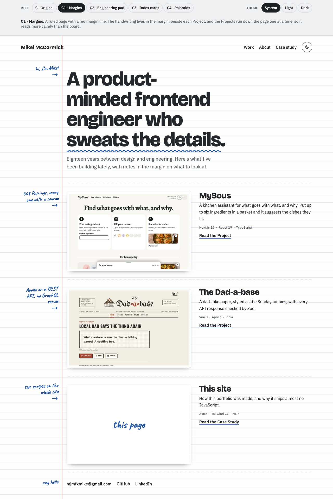
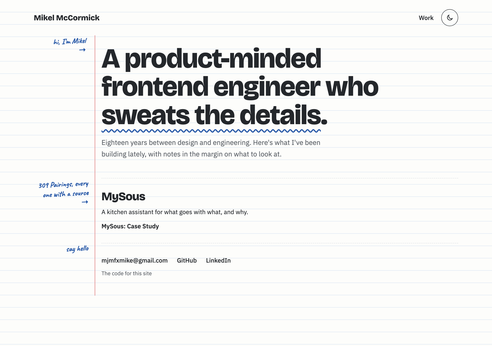
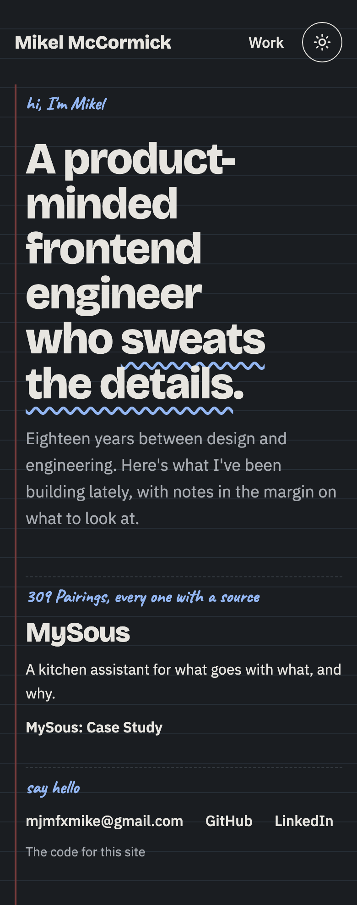

# 0001: Visual direction, the Margins notebook

Milestone 1 ([#2](https://github.com/magicianmike/portfolio/issues/2)). The site's look, chosen from throwaway prototypes, then built: the tokens, the type, the page's layout, the header, the footer and the theme toggle.

## How it was chosen

Two rounds of home-page prototypes, each one HTML file with every direction in light and dark, using the real copy and real screenshots of MySous and the Dad-a-base. Both are kept in [`0001/`](0001/).

**Round 1, four directions** ([`portfolio-variants.html`](0001/portfolio-variants.html)):

| Direction           | What it was                                                                          |
| ------------------- | ------------------------------------------------------------------------------------ |
| A · Swiss grid      | A 12-column grid, heavy rules, a cobalt accent; each Project a row like a spec sheet |
| B · Editorial       | A serif display face, a magazine front with a lead story                             |
| C · Studio notebook | Graph paper, taped-up screenshots, handwritten notes on what to look at              |
| D · Developer mono  | Projects listed like a directory, facts as keys and values                           |

The author picked **C**: it's the warmest, and its notes do a job, telling a reader what to notice in each Project.

**Round 2, four riffs on C** ([`notebook-riffs.html`](0001/notebook-riffs.html)), beside the original:

| Riff                 | What it was                                                                               |
| -------------------- | ----------------------------------------------------------------------------------------- |
| C1 · Margins         | A ruled page with a red margin line; the notes live in the margin; Projects one at a time |
| C2 · Engineering pad | Green computation paper, numbered figures, a red pen ring around the number to notice     |
| C3 · Index cards     | Dot-grid paper, square ruled cards, rubber-stamp tags                                     |
| C4 · Polaroids       | Screenshots as prints with marker captions and sticky notes                               |

The author picked **C1 · Margins**. It keeps C's handwriting but gives it a place: the margin, beside what each note is about. The Projects run down the page one at a time, so it reads more calmly than a board of tilted cards, and it leaves room for each Project's screenshot in milestone 3.

## What was built

- **The page is ruled,** a faint line every 2rem behind everything, with a red margin line between a 9rem margin column and the text. The line starts below the header, so it never runs through the name.
- **Margin notes** (`MarginNote`) are in Caveat, in the pen's blue, turned a few degrees, right-aligned against the margin line with an arrow at the block they're about. On a phone there's no margin: the line moves to the left edge and each note sits above its block, flush left. The dashed rule that starts a section goes above the note, so the note opens its section rather than closing the last one.
- **Each Project has a note** (`note` in the schema): the one thing to look at. MySous's is "309 Pairings, every one with a source". The glossary has **Margin note**.
- **Type:** Bricolage Grotesque for headings, IBM Plex Sans for reading, Caveat for the handwriting. All three are self-hosted by Astro's fonts API at build time, Latin only, with metric-matched fallbacks, so the site makes no requests to a font service. The heading and the body's regular weight are preloaded.
- **Tokens** are CSS variables in `global.css`, exposed to Tailwind through `@theme inline` (ADR 0002): paper, rule, margin line, text, muted text, pen, edge and card. Dark mode reassigns them, under the system's setting until the Visitor chooses, and under `data-theme` after. No raw colour appears outside that file.
- **The theme toggle** is a button named "Dark theme" with `aria-pressed`, showing a moon to go dark and a sun to go light. It follows the system until pressed, and keeps following it as the system changes. A press is remembered in this browser (`theme`), and an inline script in the head applies it before the first paint. Without JavaScript the toggle stays hidden and the page follows the system (ADR 0004).
- **The header** has the name, linking home, the main navigation and the toggle. The navigation lists only built pages, so for now it's "Work". About and Case study join when their milestones land.
- **The footer** has the contact links (email, GitHub, LinkedIn) under a "say hello" note, and a link to this site's code.
- **A skip link,** "Skip to content", is the first stop on every page.

## Defaults, not asked

- The hero keeps the prototype's headline, "A product-minded frontend engineer who sweats the details.", as the page's `h1`; the name is the header's link. Milestone 2 revisits the copy.
- The pen's blue is held to text contrast (4.5:1) everywhere, since it marks links, notes and focus.
- The margin line is decorative, so it isn't held to a contrast ratio.

## Tests

- `src/styles/tokens.test.ts` (`npm test`, Node's own test runner, which runs TypeScript as it is): text, muted text and the pen on paper and on card are at least 4.5:1 in both themes, read from the tokens themselves; and the system's dark theme matches the toggle's.
- Playwright, in Chromium and iPhone WebKit: the header and footer links; the theme follows the system until chosen; a choice is remembered and applied before any module script runs; the skip link moves focus to the content (Chromium only, as iOS has no Tab key); axe in both themes, after the fonts load.

## Not done yet

- **VoiceOver:** the author's pass on a Mac and an iPhone, before merging.
