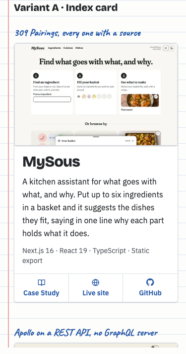
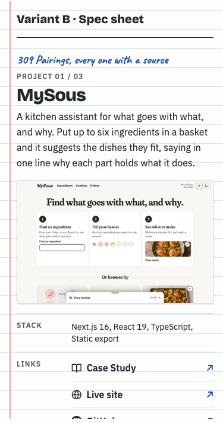
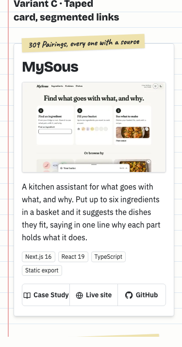
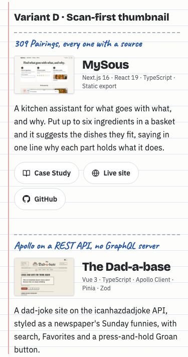
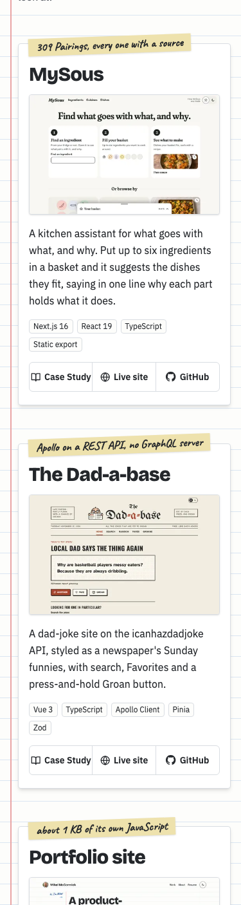
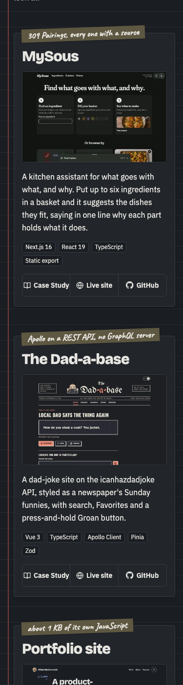
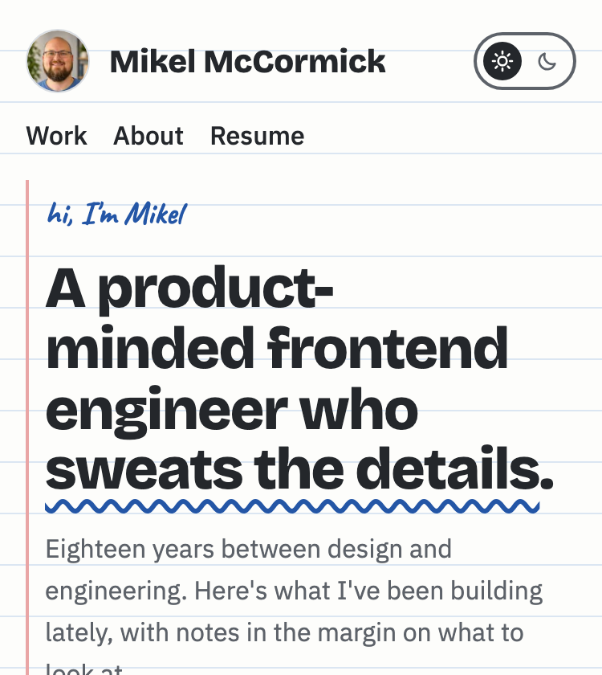

# 0002: Mobile pass, Projects as taped cards

A pass over the site at phone width (375px, down to 320px). The home page's hero and the header took too much of the first screen, and the Work section ran its Projects together: a dashed rule, a note, a screenshot, a name, a pitch, tags and links, all at one spacing, so one Project's links ran into the next one's note. Wider screens are unchanged.

## How the Work layout was chosen

Four layouts for a Project on a phone, each built as a page from the real content and compared at 375px:

| Variant        | What it was                                                                                                       |
| -------------- | ----------------------------------------------------------------------------------------------------------------- |
| A · Index card | A white card: screenshot flush on top, the stack as one muted line, the links a bar of three along the bottom     |
| B · Spec sheet | Name and pitch first, then the screenshot, then labelled rows: Stack, and Links one per row; a solid rule between |
| C · Taped card | A card with the note on tape across its top edge, the name above the screenshot, the links a segmented row        |
| D · Scan-first | A small thumbnail beside the name and stack, then the pitch and pill-shaped links; the dashed rules kept          |

| A                                | B                                | C                                | D                                |
| -------------------------------- | -------------------------------- | -------------------------------- | -------------------------------- |
|  |  |  |  |

The author picked **C**. Each card is a clear unit, so one Project no longer runs into the next. The tape keeps the notebook's handwriting and gives the note a job, labelling the card, and the name comes before the screenshot, so a reader knows what they're looking at. B was the most structured but the longest; D was the most compact but shrank the screenshot to a thumbnail.

## What was built

- **Work, on a phone:** each Project is a card. `MarginNote` takes a `taped` option: on a phone the note becomes a tape label overlapping the card's top edge, and from `md` it's the margin note it was. It stays one element, so the note isn't read twice. The name moves above the screenshot, the pitch drops to `text-base`, the tags shrink, and the links are a segmented row of equal buttons, icon above label, at least 56px tall. At 375px a side-by-side icon left "Case Study" crowded, so they stack.
- **The hero** is `text-4xl` on a phone (four lines rather than six), so the first card shows above the fold.
- **The header,** on a phone, puts the name and theme toggle on the top row, the toggle right-aligned, and the navigation on a row beneath.

- **About:** the photo is centred above the text on a phone, and a little larger at every width.
